# AI Use Cases

ChatGPT・Claude.aiのチャット／Work／スケジュールで、AIへ任せる作業と人間の判断を設計した事例集。Claude Codeのルーティンと、Claude Codeの会話で続けている運用も含みます。図から概要をつかみ、気になるケースへ進めます。

## 全体図

<a href="systems/overview/">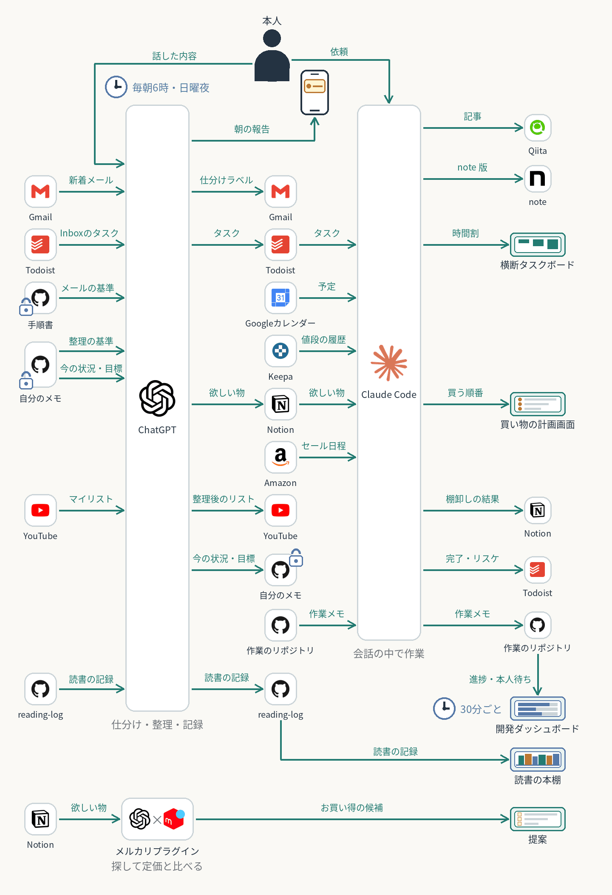</a>

**[AIに任せている仕組みの全体図](systems/overview/)**

紹介資料（1 ファイルの Web ページ）：[AIに任せていること.html](docs/AIに任せていること.html)。開いた画面の右上にある「Download raw file」で保存し、保存したファイルをブラウザで開く。

## 仕組み全体

| 日々のタスク管理 | 文脈と読書の循環 | 横断タスクボード |
| --- | --- | --- |
| [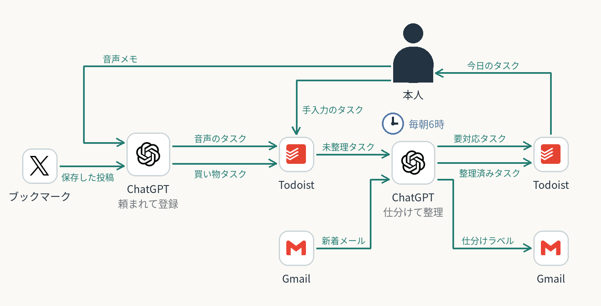](systems/daily-task-hub/) | [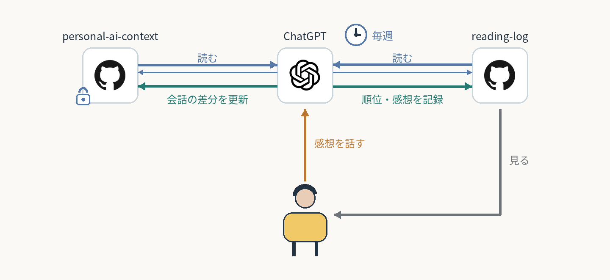](systems/context-reading-loop/) | [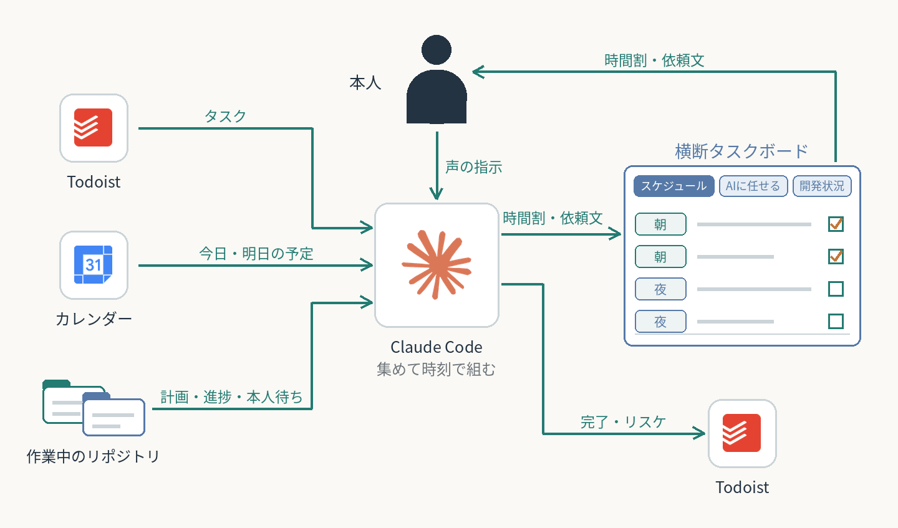](systems/cross-task-board/) |
| **[メール・音声・手入力から実行へ](systems/daily-task-hub/)** | **[会話の文脈を次に読む本へつなぐ](systems/context-reading-loop/)** | **[今日やることを1枚のボードにまとめる](systems/cross-task-board/)** |

| 欲しい物から購入まで | 記事のネタから投稿まで |
| --- | --- |
| [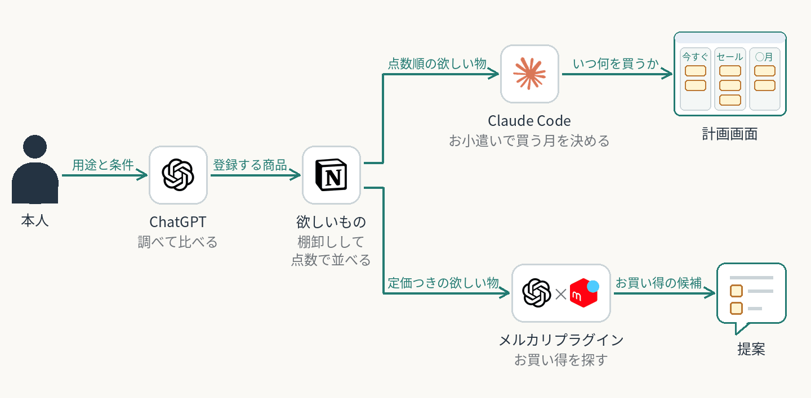](systems/shopping-plan/) | [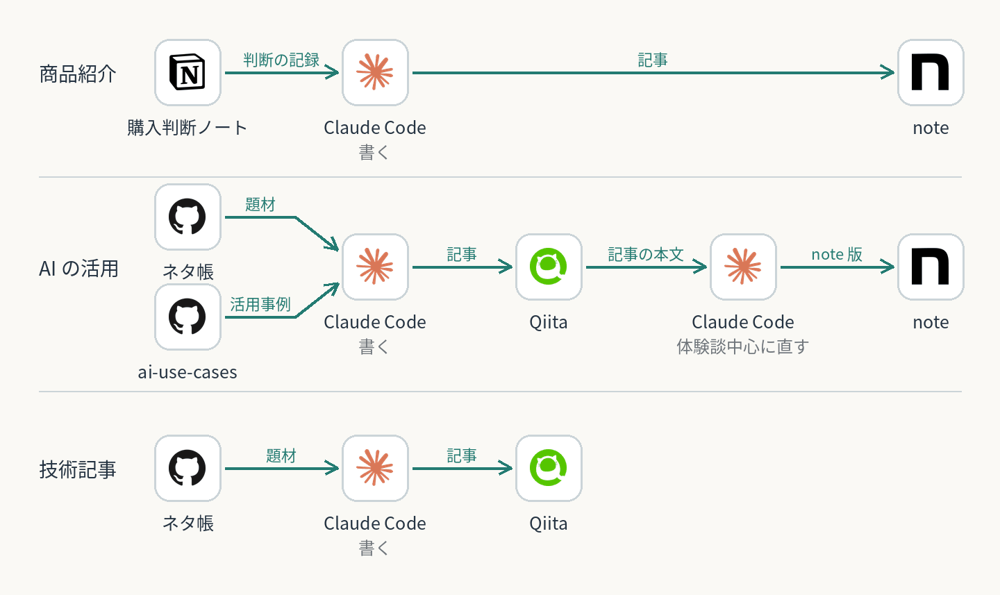](systems/article-writing/) |
| **[欲しい物はNotionの1つの一覧に、買う月は値段とセールから決める](systems/shopping-plan/)** | **[記事の種類でネタの出どころと出す先を分ける](systems/article-writing/)** |

[全体構成の一覧](systems/README.md)

## 個別ケース

| GUI作業の委譲 | 定期レビューの自動化 | 毎朝のメール仕分け |
| --- | --- | --- |
| [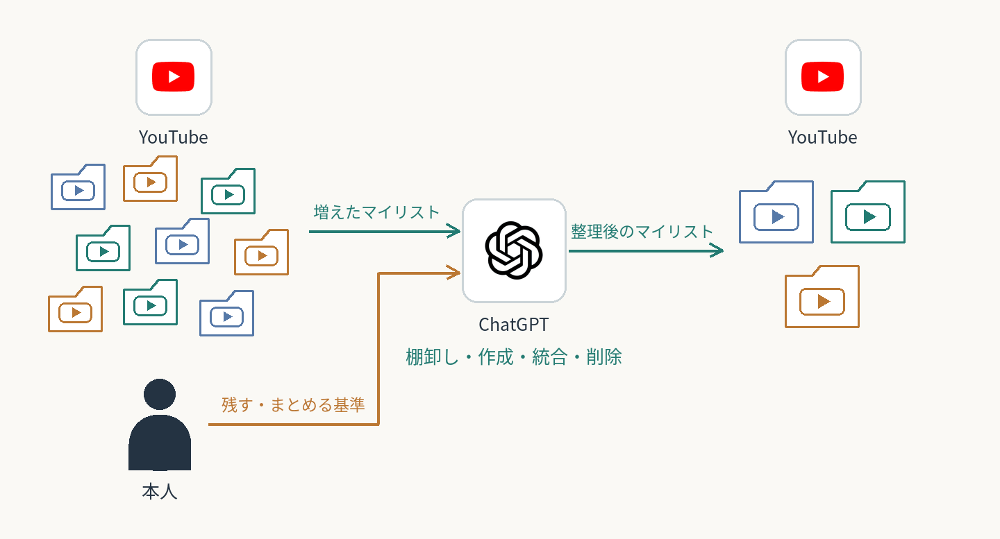](cases/youtube-playlist-cleanup/) | [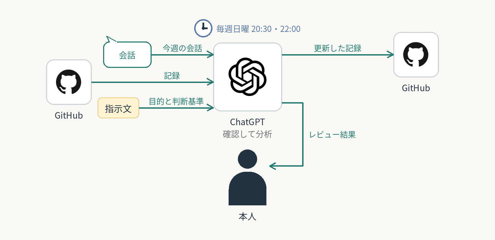](cases/scheduled-reviews/) | [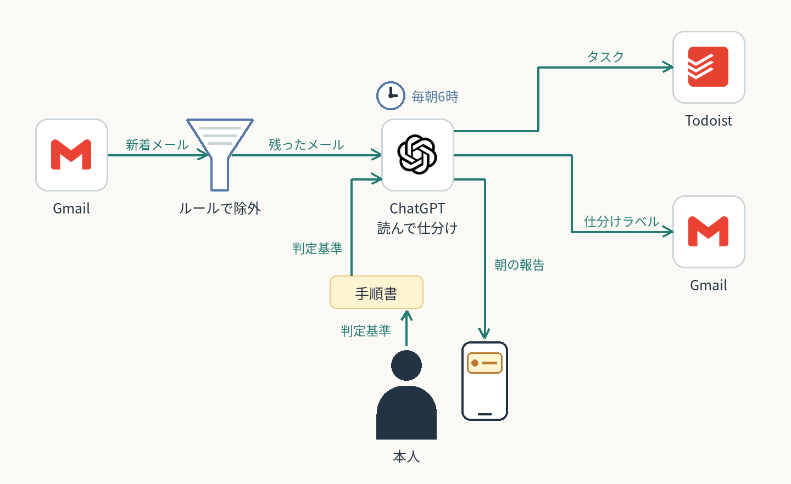](cases/daily-email-triage/) |
| **[YouTubeマイリスト整理](cases/youtube-playlist-cleanup/)** | **[スケジュールによる定期レビュー](cases/scheduled-reviews/)** | **[毎朝のメール仕分け](cases/daily-email-triage/)** |
| AIが棚卸し・分類・操作を担当。人間が整理方針を決める。 | AIが定期的に情報を確認・分析。人間が方針と次の行動を決める。 | AIが毎朝メールを読んで仕分け・通知。人間が判定基準を決め、対応する。 |
| 整理の完了は本人の申告／件数・変更前後は未確認 | 現行設定と、直近の完了記録・保存の報告を確認／成果物の独立した検証と効果測定は未実施 | 設定・出力を確認／判定の正確さと効果は未測定 |

| 毎朝のタスク整理 | ブックマークの整理 | 買い物の計画 |
| --- | --- | --- |
| [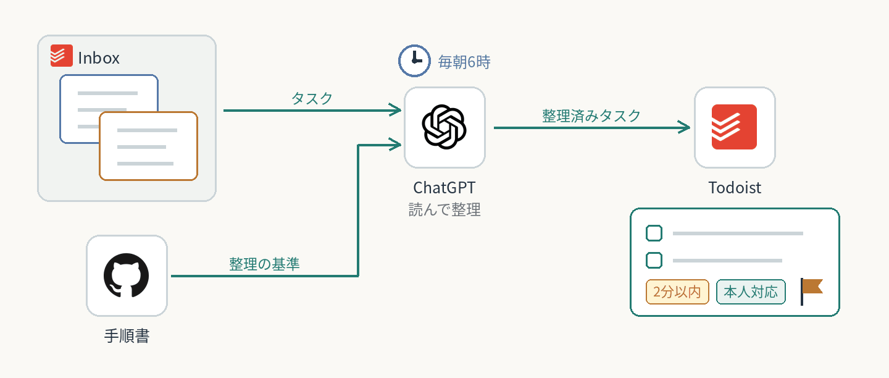](cases/daily-todoist-triage/) | [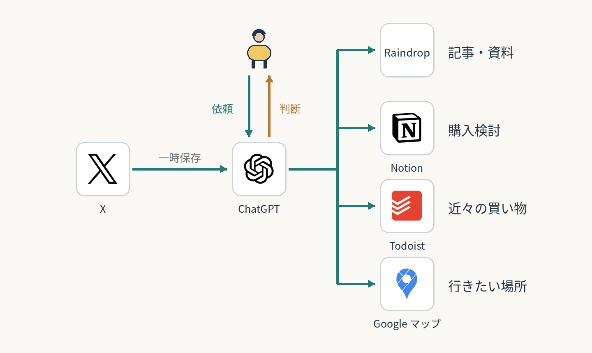](cases/bookmark-to-action/) | [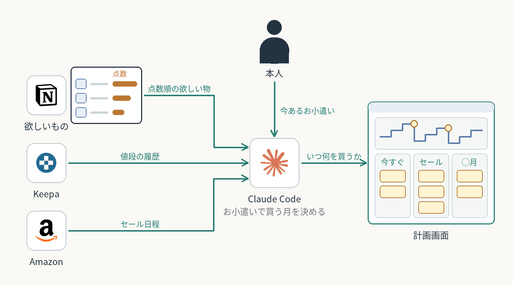](cases/allowance-shopping-plan/) |
| **[毎朝のTodoist整理](cases/daily-todoist-triage/)** | **[ブックマークを使える情報へ](cases/bookmark-to-action/)** | **[お小遣いの買い物計画](cases/allowance-shopping-plan/)** |
| AIがInboxの分類・期限・順序を整理。人間が優先度と除外範囲を決める。 | AIが分類・移行。人間が保存先・例外・使う情報を決める。 | AIが欲しいものを読み、積立を分けた計画を画面に出す。人間が入力と順番を決める。 |
| 現行設定・直近の完了記録と更新検証の報告を確認／結果の独立検証・効果測定は未実施 | 初回の整理を確認／定期の実行は停止中で、気づいたときに依頼 | 試作・改善中。初回の画面を確認／効果は未測定 |

| 横断のスケジュール | 商品比較の記録 | 記事の執筆と投稿 |
| --- | --- | --- |
| [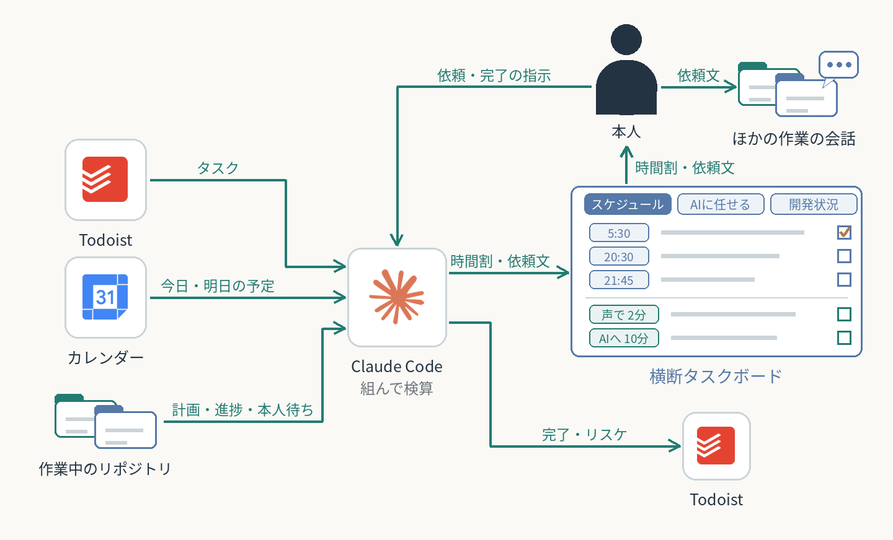](cases/daily-cross-task-board/) | [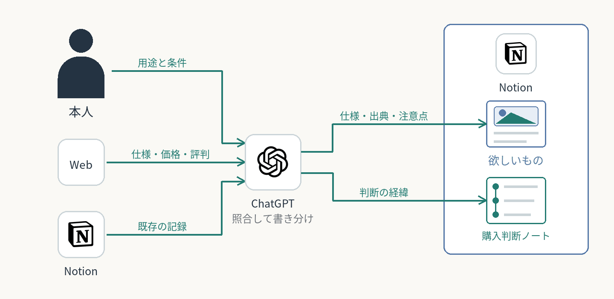](cases/shopping-decision-notes/) | [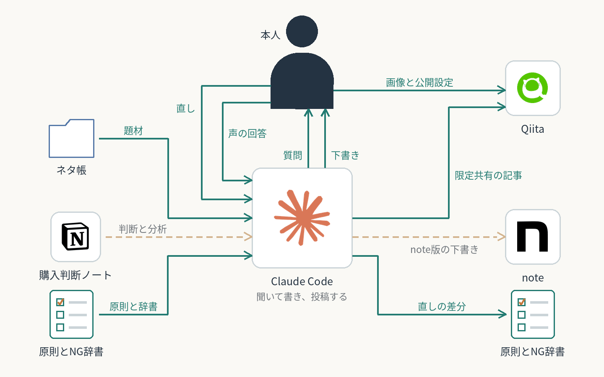](cases/article-drafting-workflow/) |
| **[横断タスクボードで今日と明日を組む](cases/daily-cross-task-board/)** | **[商品比較の判断をNotionに残す](cases/shopping-decision-notes/)** | **[聞き取りから記事を書き、投稿まで](cases/article-drafting-workflow/)** |
| AIがタスク・予定・各リポジトリを読み、時刻と配分の予定をボードに書く。人間が時間割の型を決め、ボードを見て実行する。 | AIが比較の経緯を整理。人間が判断基準を伝え、解釈を訂正する。 | AIが資料を読んで質問し、下書きと校正をして、限定共有で投稿する。人間が声で答え、直し、公開する。 |
| 8日分の作業記録で更新と検算を確認／効果は未測定 | 判断ノートの保存内容と導線を確認／記事での再利用・継続効果は未検証 | Qiitaの記事1本の公開と書き直しを確認／noteの自動下書き・効果は未検証 |

| 次の会話への作業メモ | 開発の観測画面 | 家計の見通し |
| --- | --- | --- |
| [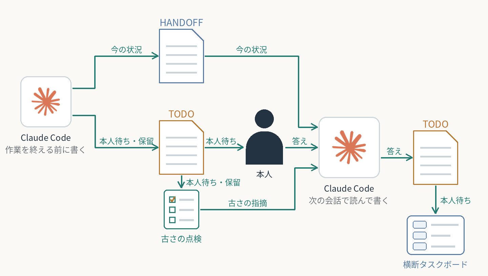](cases/handoff-and-todo-files/) | [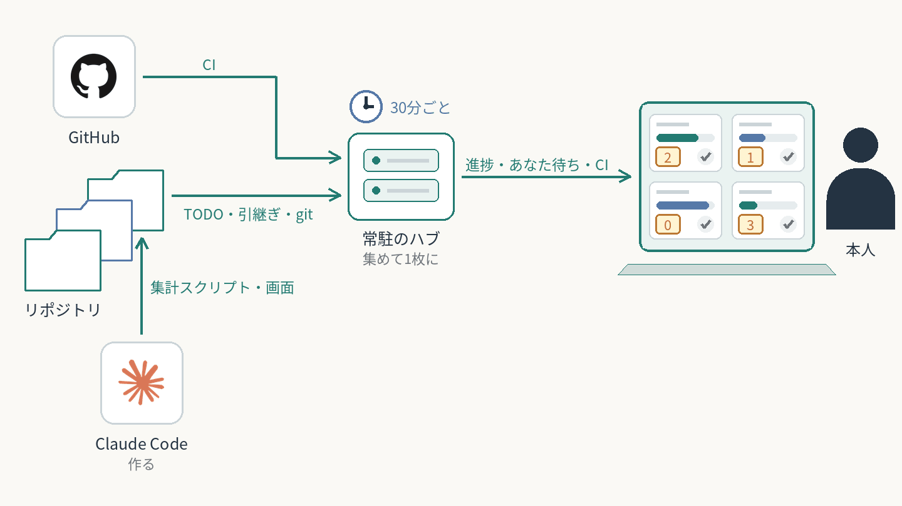](cases/dev-dashboard-hub/) | [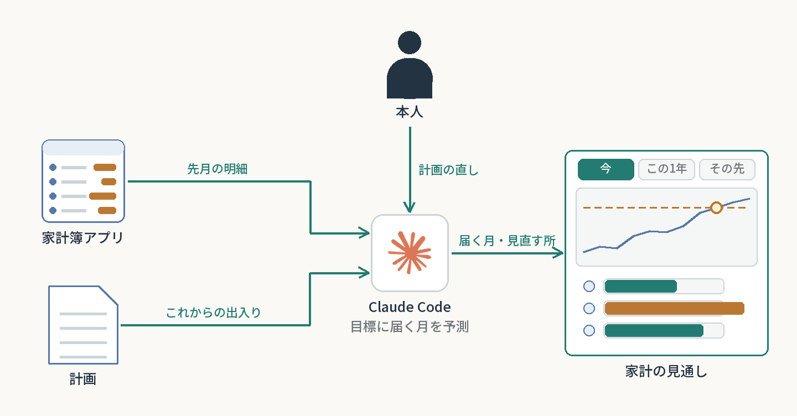](cases/household-cashflow-forecast/) |
| **[次の会話への作業メモと、本人待ちの置き場](cases/handoff-and-todo-files/)** | **[開発の状態を1画面に集めて常駐させる](cases/dev-dashboard-hub/)** | **[家計の口座が目標額にいつ届くかを予測する](cases/household-cashflow-forecast/)** |
| AIが作業を終える前に次の会話への作業メモと本人待ちを書き、答えを記録。人間が会話で答える。 | AIが正本を読んで描く画面を各リポジトリに作る。人間は足すリポジトリと指標を決め、画面は見るだけ。 | AIが明細を読んで検算し、計画と合わせて先の月まで予測して画面に出す。人間が暮らしの値を答え、見直すかを決める。 |
| 決まり・点検スクリプト・フック・TODO.mdへ移したコミットを確認／古くならずに続くか・効果は未検証 | 常駐と4リポジトリが1画面に並ぶことを確認／見る頻度と効果は未測定 | 最初の予測と画面の組み直しを確認／月ごとの更新が続くか・効果は未確認 |

図は仕組みの概念図です。実画面や実績の証拠ではありません。
図のサービスのロゴは各社の商標で、サービスを指すためにだけ使っています（出どころは [scripts/logos/README.md](scripts/logos/README.md)）。

Claude Code製の独立アプリ・プロジェクトは、各リポジトリとポートフォリオで紹介します。

<details>
<summary>AIでケースを追加・更新する方へ（最初に読む）</summary>

**最初に最新mainの [AGENTS.md](AGENTS.md) を全文読み、指定された読み取り順に従ってください。** 操作方法やチャットが変わっても、このファイルが方針の正本です。

別チャットでは次の開始文を使えます。

```text
GitHubの n-yoshida-dev/ai-use-cases を対象に、今回のAI活用事例を記録してください。
最初に最新mainのAGENTS.mdを全文読み、そこに指定された順でREADME・記録プロンプト・テンプレート・関連ケースを読んでください。
登録対象・日本語の概念図・公開ルールを守り、同じ事例があれば更新してください。
参照できない会話や未確認の成果を補わないでください。
```

[記録プロンプト](prompts/capture-case.md) ／ [図の仕様](templates/cover-brief.md)

指示ファイルは別のチャットへ自動では届きません。依頼するときに、リポジトリと読む順の指定を渡してください。

</details>
