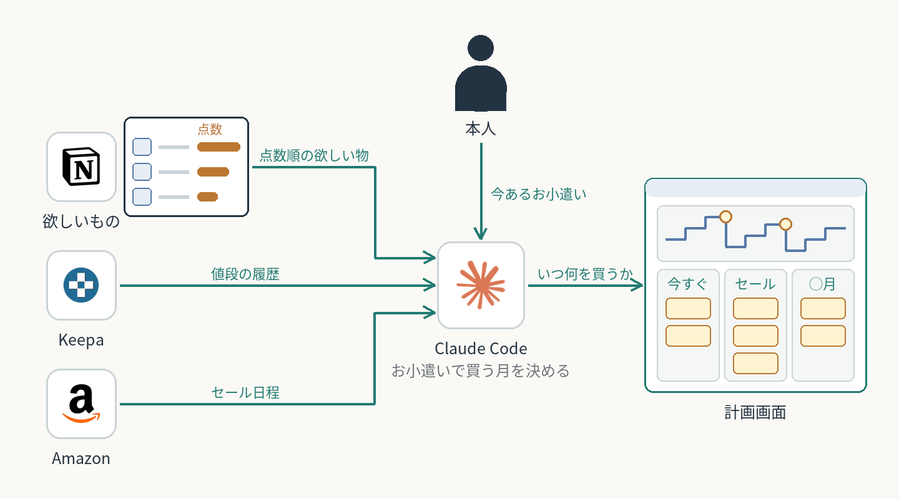
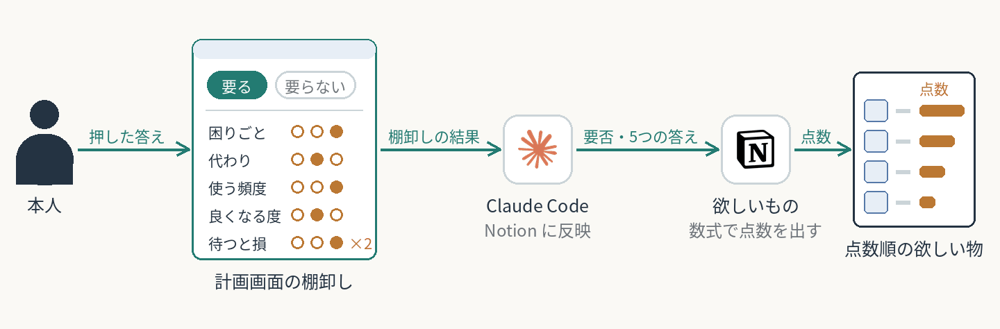
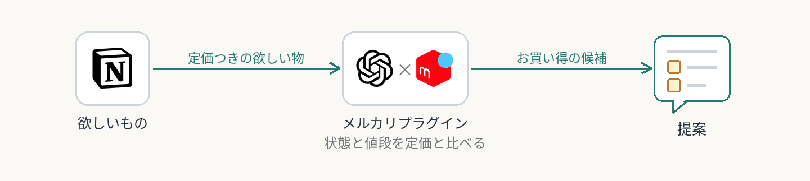
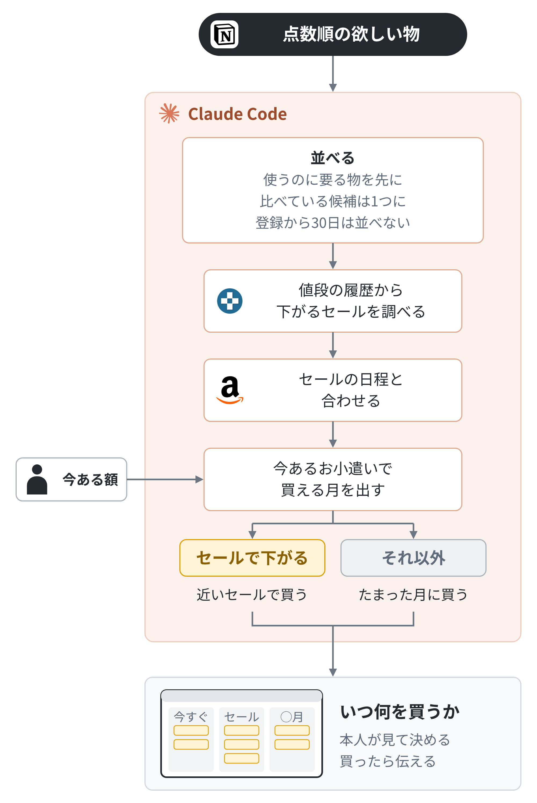
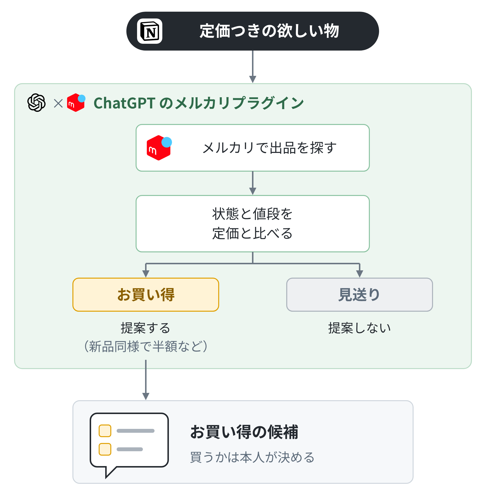

# お小遣いの買い物計画をAIと組む

月に自由に使えるお金は限られ、安い順に買うと高いものがいつまでも買えない。欲しいものはNotionのデータベースに置いたまま、Claude Codeがそれを読み取って買う順と買える月を出し、その計画をアーティファクト（claude.ai上のWebページ）に表示する。
**試作・改善中。2026-10-22に初回の計画画面を作成。効果は未測定。**

**AI：** Notionの読み取り、積立と買う順の計算、計画画面の作成、決まったことを画面とNotionに反映（Notionへは本人の了承後）。  
**人間：** 欲しいものの入力（画像つき）、分け方・買う順の最終判断。

本人は計画画面だけを見て、隣のチャットで順番を相談する。

ChatGPTは候補の商品の調査・比較と、Notionの欲しいもの（1商品1行）への登録を担当する。2026-10-31に、メルカリの複数の出品を状態・新品との差・注意点で比較して保存した記録を確認した。元の検索の操作ログ、実物の状態、購入の成果は未確認。比較で本人が何を重視したかの記録は、別の[購入判断ノートの事例](../shopping-decision-notes/)で扱う。

再利用できる工夫：

- 入力場所は動かさない。以前、欲しいものをNotionからGitHub上のファイルへ移す仕組みを作ったが使いづらく、Notionに戻った。画像つきで見やすいNotionを正本のままにする。
- 本人が見る場所は画面1つ。買う順はNotionにも作業メモにも書かず、画面に出す。画面には説明文を置かず、買う順を「今すぐ」「セール」「◯月」のような買う時期のまとまりで見せ、レイアウトで読み取れるようにした。決まりは手順書にだけ書く。比べている候補は1行にたたみ、画像を重ねて候補の数を見せる。その行を押すと、候補が下に横並びで開く。
- 最初は積立を「高いもの用」「普段のもの用」に分けたが、高すぎる物を保留に移し、点数で並べるようにしたら分ける理由がなくなり、ひとつの積立に戻した。高額な出費を毎月の積立で狙うのをやめたことが大きかった。

- 高いものにも段階をつける。お小遣いの10か月分を線とし、超えるものは積み立てで狙わず「保留」に置く。お小遣いが増えると線が上がり、保留のものが候補に戻る。線を金額で固定しないので、引き直しが要らない。
- 棚卸しには画面のボタンを使う。本人が押した「いる／いらない」と質問の答えは保存され、Claudeがまとめて Notion に反映する。件数が多くても、本人は押すだけで済む。

- 欲しい度（★）はその場の気分が入るので使うのをやめ、すべての物に点数が付いた時点でNotionの★の列も消した。代わりに、選択式の質問（今困っているか・代わりはあるか・どれくらい使うか・どれだけ良くなるか・待つと損するか）の合計点で並べる。「待つと損するか」は、買うまでの間に時間や効果を失い続ける物（家事を減らす家電、運動の道具など）を早めに買うための問いで、この問いの点数は2倍にしている。点数を値段で割ると安い物から買う形に戻るので、割らない。ほかの物がないと使えない物は、使うのに要る物と一緒に並べ、買う月を要る物より後にする。登録から30日は「冷ます期間」として並べない（質問に答えた物は、考えたうえで残した物なので除く）。質問の仮の答えはAIが商品情報から出し、本人は違うところだけ口頭で直す。
- 「いつ買うか」を決めるときは、商品ごとの値段の動きを考えに入れる。AIがAmazonの値段の履歴（Keepaのグラフ）を見て、その商品が過去にどのセールで下がったか（毎月の小さなセール・ブラックフライデー・プライム会員向けのセール）と、下がったときの値段を記録する。セールで下がる物は、お金がたまってから一定の日数のうちに「その商品が下がる種類のセール」が来るなら、そのセールで買うと出し、下がったときの値段で計算する。一度も下がっていない物はセールを待たない。待つ日数は高い物ほど長くし、「待つと損する」物は短く切り上げる。並ぶ順番は変えず、買う時期だけをずらす。グラフ画像から値下げの期間を読む処理はスクリプトにし、回帰テストを付けた。
- 点数はNotionにも数式の列として持たせ、Notionのビューも点数順にした。画面と同じ計算なので、Notionを開いたときも順番の感覚がずれない（買う順そのものは画面だけが出す）。
- 欲しいものを「目指す完成形」のまとまり（例：仕事机まわり）に束ね、その中を役割（モニター・照明・カメラなど）で分ける。役割ごとに「今使っている物 → これからの候補 → いつ買えるか」を1行で見せるタブと、候補どうしを値段・点数・セールで下がるかで横に並べる比較のタブを足した。束ねるのはまとめて買うためではなく、待っている間に候補を入れ替えやすくし、全体像を整理するため。
- 今ある積立も計算に入れ、「今すぐ買える物」を出す（額は画面の保存先にだけ置き、リポジトリには書かない）。予定に合わせて「この月より前には買わない」も付けられる。
- 候補を比べている途中のもの（鞄や腕時計など）は、商品ではなく「その種類がいるか」だけを先に決め、1つとして並べる。どれを買うかは順番が来てから比べる。値段は、Notionのメモに第一候補が書いてあればその候補で計算し、まだ決めていなければ候補でいちばん高いもので計算して、あとで高い方を選んでも足りなくならないようにする。

更新：2026-10-22 に保留の層、棚卸しの画面、4つの質問による点数化、比較中のものの扱いを追加。2026-10-23 に5つ目の質問「待つと損するか」、大型セールまで待つ判定、Notionの点数の列を追加し、★の列を廃止。2026-10-25 にセール待ちを商品ごとの値段の履歴（Keepa）で決める形に改定。2026-10-27 に完成形のまとまりと比較のタブを追加。2026-10-29 に、比べている候補を1行にたたんで開け閉めできる形にした。2026-11-06 に、比べている物の値段をNotionのメモにある第一候補で計算する形にし、今あるお小遣いに入っている月の分を2回数えないよう、積み立ての始まりを今ある分を聞いた日の次の月にした。

棚卸しと点数の図、メルカリでお買い得を探す図を見る

買う月を決める手順と、メルカリでお買い得を探す手順の流れ図を見る

[欲しい物から購入までの全体像](../../systems/shopping-plan/)

[一覧へ戻る](../../README.md)
