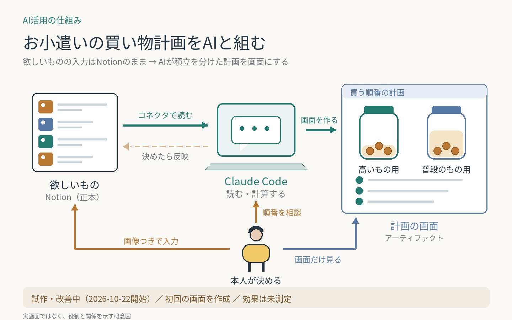

# お小遣いの買い物計画をAIと組む

月に自由に使えるお金は限られ、安い順に買うと高いものがいつまでも買えない。欲しいものはNotionのデータベースに置いたまま、Claude Codeが読み取り、積立を「高いもの用」「普段のもの用」に分けた計画をアーティファクト（claude.ai上のWebページ）に表示する。
**試作・改善中。2026-10-22に初回の計画画面を作成。効果は未測定。**

**AI：** Notionの読み取り、積立と買う順の計算、計画画面の作成、決まったことの画面とNotionへの反映（Notionは本人の了承後）。  
**人間：** 欲しいものの入力（画像つき）、分け方・買う順の最終判断。

本人は計画画面だけを見て、隣のチャットで順番を相談する。

再利用できる工夫：

- 入力場所は動かさない。以前、欲しいものをNotionからGitHub上のファイルへ移す仕組みを作ったが使いづらく、Notionに戻った。画像つきで見やすいNotionを正本のままにする。
- 本人が見る場所は画面1つ。買う順はNotionにも作業メモにも書かず、画面に出す。
- 積立を分け、数十万円の大きな出費が数万円の日用品に押し出されないようにする。

- 高いものにも段階をつける。お小遣いの2年分を超えるものは積み立てで狙わず「保留」に置き、お小遣いが増えると線が上がって候補に戻る。線を金額で固定しないので、引き直しが要らない。
- 棚卸しは画面のボタンで。本人が「いる／いらない」と欲しい度を押すと保存され、Claudeがまとめて Notion に反映する。件数が多くても、本人は押すだけで済む。

更新：2026-10-22 に保留の層と棚卸しの画面を追加。

[一覧へ戻る](../../README.md)
