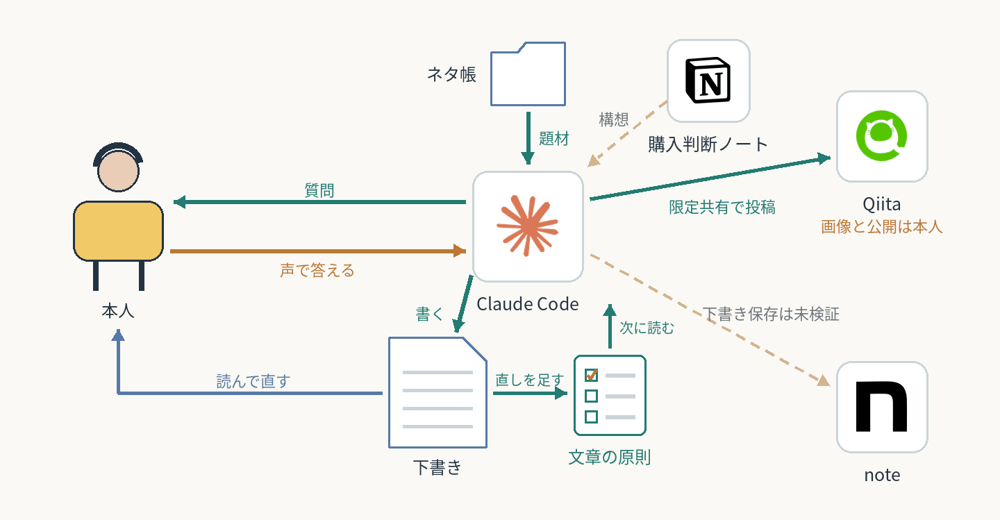

# 聞き取りから記事を書き、投稿まで

AIに記事を任せると、主語を抜く・繰り返す・凝った言い回しのAIらしい文章になる。長いルール集で防ぐと、ルールが定型文を生み、手入れが執筆を上回る月もあった。2026年10月、Claude Codeが資料を読んでから質問し、本人が声で答える聞き取り型に作り直した。本人の直しは文章の原則とNG辞書に積み上げ、次の記事で機械に止めさせる。
**Qiitaの記事1本を公開し、公開後の書き直しまで実施。note版はレビュー中で、自動の下書き保存は未検証。効果は未測定。**

**AI：** 資料を読んで質問、本文を一度に書く、図の提案とPNG化、textlintで校正、QiitaへAPIで限定共有の投稿と公開本文の取り込み、直しを原則と辞書に反映。  
**人間：** 題材選び、声で答える、構成のOK、本文の直し、タイトルの決定、画像を貼って公開。

工夫：

- 素材に無い事実は聞き、原文を残す。
- 直す前の状態を残し、差分と指示を原則に足す。原則は短く、嫌う言い回しは辞書で止める。
- 見出しごとの承認待ちをやめ、構成のOKのあと一度に書く。
- 両方に出すときは、note版を体験談中心にし、作り方はQiitaへリンクする（本人の決定）。
- 画像はAPIで上げられず「ここに貼る」の印にし、本人が貼って公開する。
- 構想：買い物の記事はNotionの購入判断ノートを材料にし、使った感想だけを書く（未着手）。

[公開した記事（Qiita）](https://qiita.com/n-yoshida-dev/items/5582e55143ee9bb57934) ／ [購入判断ノートの記録](../shopping-decision-notes/)

[一覧へ戻る](../../README.md)
