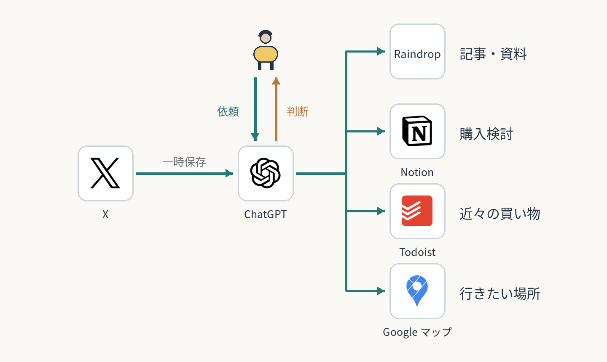

# ブックマークを使える情報へ整理

Xにたまったブックマークを、読む・検討する・実行する情報に整理する。分類の設計と各サービスの操作はChatGPTに任せる。
**初回の整理結果を確認。定期運用は停止中で、本人が気づいたときに頼む。**

**AI：** 棚卸し、分類、重複照合、移行、読書候補の選定、変更記録。  
**人間：** 保存先の役割、残す基準、最新DBの指定、例外判断、依頼するタイミング、実際の購入・読書。

初回はX・Raindrop・Notion（購入検討）・Todoist・Mapsの間で移行し、移行後の保存状態を確認した。旧wishlistは履歴として保管した。

再利用の工夫は「保存先を確認してから一時保存を外す」「古さだけで削除しない」「旧DBの保全を確認」「記事と行動を分ける」。2026-10-30に定期運用から随時の依頼へ変えた。2026-10-31時点のChatGPTの予定一覧に、ブックマークの振り分けの予定はない。削減時間は未測定。

[タスク管理の全体像](../../systems/daily-task-hub/) ／ [GUI整理の関連例](../youtube-playlist-cleanup/)

[一覧へ戻る](../../README.md)
