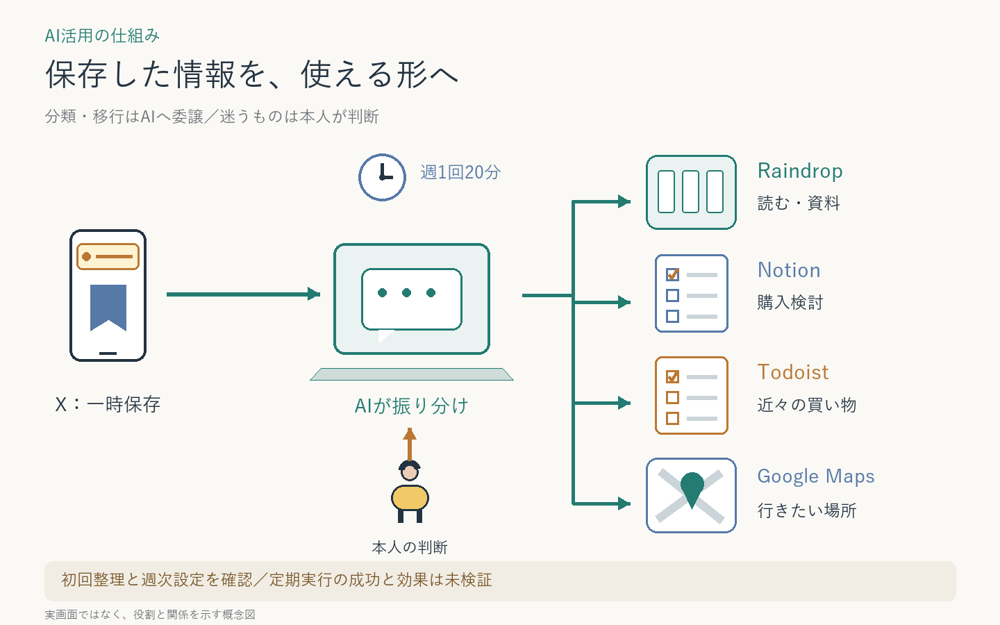

# ブックマークを使える情報へ整理

Xに積み上がった保存を、読む・検討する・実行する情報へ整理。ChatGPTに分類設計と各サービスの操作を委譲し、週次運用へつなぐ。
**初回の整理結果と週次設定を確認。定期実行の成功・継続効果は未検証。**

**AI：** 棚卸し、分類、重複照合、移行、読書候補の選定、変更記録。  
**人間：** 保存先の役割、残す基準、最新DB、例外判断、実際の購入・読書。

初回はX・Raindrop・wishlist・Todoist・Maps間の移行と、移行後の保存状態を確認した。旧wishlistは履歴として保管した。

再利用の工夫は「保存先を確認してから一時保存を外す」「古さだけで削除しない」「旧DBの保全を確認」「記事と行動を分ける」。本人が選んだ週次スケジュールを登録した。削減時間は未測定。

[タスク管理の全体像](../../systems/daily-task-hub/) ／ [GUI整理の関連例](../youtube-playlist-cleanup/)

[一覧へ戻る](../../README.md)
