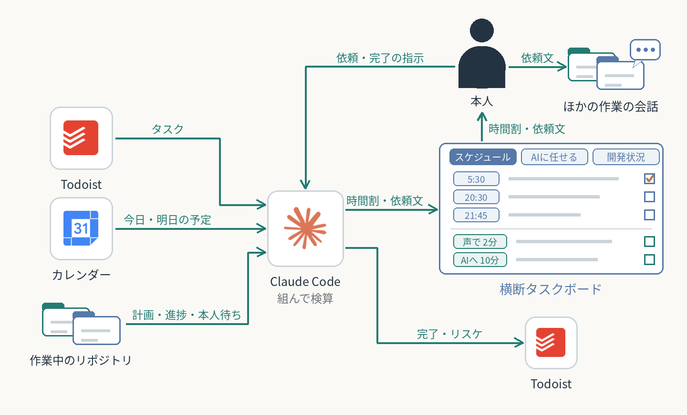
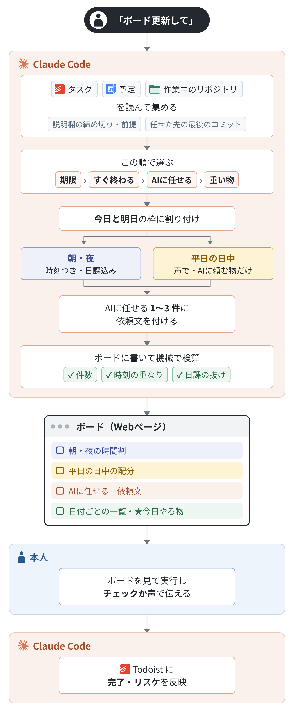

# 横断タスクボードで今日と明日を組む

Todoistのタスクと、学習・アプリ開発・執筆のリポジトリの作業を並べて、今日やることを決めたい。PCのClaude CodeがTodoist・Googleカレンダー・各リポジトリのコミットと計画・本人待ちのTODO.mdを読み、時刻つきの今日と明日のスケジュールを、データベース付きのアーティファクト（claude.ai上のWebページ）に書く。
**2026-10-21から使用（作業記録は15日分）。自動実行はしない。効果は未測定。**

**AI：** 入力の読み取り、優先順位に沿った割り付け、ボードのデータベースの書き換えと検算、本人の指示によるTodoistへの反映、ほかの作業の会話へ渡す依頼文の作成、ログインが要るブラウザ作業。  
**人間：** 「リスト作って」「更新して」の依頼、時間帯と型の決定、チェックや声での完了・リスケの指示、AIに任せるかの判断、ブラウザのログイン。

再利用できる工夫：

- 夜と朝は時刻で区切り、毎日のルーティン（日記・筋トレ・資格の問題・読書）を型として入れる。開始が遅れた日は型ごと後ろへずらし、ルーティンは消さない。
- 平日の日中（仕事の合間）は時刻を決めず「配分の枠」にする。所要時間だけを出し、上から順にやる。入れるのは、声で答えるもの・スマホからAIに声で頼むもの・ChatGPT（Work）のブラウザ操作に任せるもの、の3種類だけ（本人の決定）。
- 「AIに任せる」タブで、AIに渡せるタスクを状態（すぐ進められる・作業中・結果を見る・材料待ち・別のAI・保留）で分け、次に何が要るかを1行で書く。
- 別のリポジトリの作業はタスク管理の会話で続けず、その作業用に新しく開く会話に貼る依頼文を作る。タスク管理の会話のまま記事を直すところまで続くのを、本人が嫌ったため。依頼文の作成はスキルにした。
- タスクにはなぜやるのか・どこから来たか・作業フォルダを書く。名前だけでは、どこで何をやるか分からないため。
- 本人待ちは各リポジトリのTODO.mdにだけ置き、ボードは読むだけ。古さは点検スクリプトとフックで機械に見つけさせる。付箋の箱（Beads）は写しだったので古くなり、やめた（本人の判断）。
- 判断は本人、検算は機械。書き込みのあとに件数を数え直し、時刻の重なりとルーティンの抜けを確かめる。Todoistの完了・リスケ・削除は本人が指示したときだけ。
- AIに任せて作業中のタスクは、相手のリポジトリの最後のコミット（日時と件名）を毎回見て、終わったのか止まったのかを見分ける。TODO.mdでは閉じたのにボードで未完の物も出す。
- Todoistの日付は実行日として扱う（本人「それは締め切りじゃなくて実行日ですからね」）。締め切りと前提条件は説明欄に書いてあるので、該当する行だけを毎回読む。
- 「日付」のタブで、今日これだけはやる物を★で先頭に置き、3回先送りした物を赤にする。空き時間（5・15・30分、スマホ）で絞り込める。

更新：2026-10-23 夜の時間割の型。2026-10-25 ルーティンを後ろへずらす決まりと「次の候補」の表示。2026-10-27 「AIに任せる」タブと、手順をまとめたスキル2つ（ボードの更新・依頼文の作成）。2026-10-28 平日の日中の配分の枠、開発状況を見る入口をボードに一本化。2026-10-29 本人待ちをTODO.mdへ移した。2026-10-31 毎朝のTodoist整理と役割を分けた（今日やるべきことは毎朝の整理、PCで作業するときの細かい順番はボード。本人の判断）。PCともAIとも関係ない作業は載せず、期限の無いタスクからAIに任せるものを毎回1〜3件出し、月1回Todoistの全件を棚卸しする。ログインが要るブラウザ作業はClaudeを先に使い、ChatGPT Workは予備にする。2026-11-04〜06 作業の置き場を取り組みごとのフォルダに組み替えてWindowsへ移し、ボードの会話から内蔵ブラウザと本人のChromeを直接動かせるようにした（作業ごとに選ぶ）。2026-11-06 点検の道具に、閉じた物の逆向きの突き合わせと、作業中の依頼の相手の最後のコミットを足した。2026-11-08 「日付」のタブと、Todoistの日付を実行日として読む決まり。

時間割を組む手順の流れ図を見る

[横断タスクボードの全体像](../../systems/cross-task-board/) ／ [毎朝のTodoist整理](../daily-todoist-triage/)

[一覧へ戻る](../../README.md)
