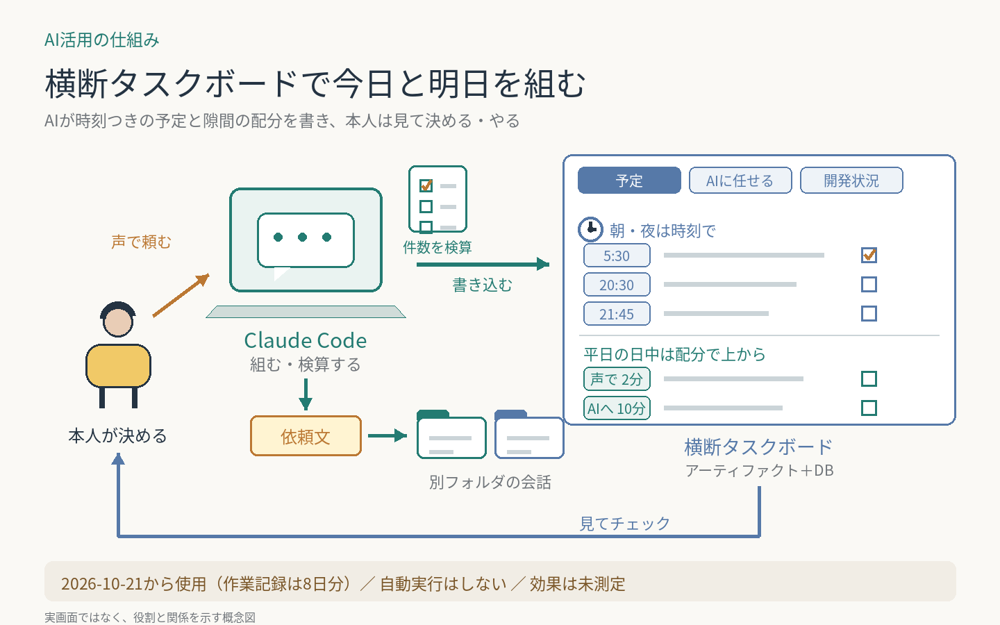

# 横断タスクボードで今日と明日を組む

Todoistのタスクと、学習・アプリ開発・執筆のリポジトリの作業を並べて、今日やることを決めたい。PCのClaude CodeがTodoist・Googleカレンダー・各リポジトリのコミットと計画・人間待ちのTODO.mdを読み、時刻つきの今日と明日のスケジュールを、データベース付きのアーティファクト（claude.ai上のWebページ）に書く。
**2026-10-21から使用（作業記録は8日分）。自動実行はしない。効果は未測定。**

**AI：** 入力の読み取り、優先順位に沿った割り付け、ボードのデータベースの書き換えと検算、本人の指示によるTodoistへの反映、別のフォルダの会話へ渡す依頼文の作成。  
**人間：** 「リスト作って」「更新して」の依頼、時間帯と型の決定、チェックや声での完了・リスケの指示、AIに任せるかの判断。

再利用できる工夫：

- 夜と朝は時刻で区切り、毎日のルーティン（日記・筋トレ・資格の問題・読書）を型として入れる。開始が遅れた日は型ごと後ろへずらし、ルーティンは消さない。
- 平日の日中（仕事の合間）は時刻を決めず「配分の枠」にする。所要時間だけを出し、上から順にやる。入れるのは、声で答えるもの・スマホからAIに声で頼むもの・ChatGPT（Work）のブラウザ操作に任せるもの、の3種類だけ（本人の決定）。
- 「AIに任せる」タブで、AIに渡せるタスクを状態（すぐ進められる・作業中・結果を見る・材料待ち・別のAI・保留）で分け、次に何が要るかを1行で書く。
- 別のリポジトリの作業は、タスク管理の会話で続けない。そのフォルダの新しい会話に貼る依頼文を作る（本人がタスク管理の会話で記事の直しまで続くのを嫌ったため。スキルにした）。
- タスクには、なぜやるのか・どこから来たか・作業フォルダを書く。名前だけでは、どこで何をやるか分からないため。
- 人間待ちは各リポジトリのTODO.mdにだけ置き、ボードは読むだけ。古さは点検スクリプトとフックで機械に見つけさせる。付箋の箱（Beads）は写しで古くなったのでやめた（本人の判断）。
- 判断は本人、検算は機械。書き込みのあとに件数を数え直し、時刻の重なりとルーティンの抜けを確かめる。Todoistの完了・リスケ・削除は本人が指示したときだけ。

更新：2026-10-23 夜の時間割の型。2026-10-25 ルーティンを後ろへずらす決まりと「次の候補」の表示。2026-10-27 「AIに任せる」タブと、手順をまとめたスキル2つ（ボードの更新・依頼文の作成）。2026-10-28 平日の日中の配分の枠、開発状況を見る入口をボードに一本化。2026-10-29 人間待ちをTODO.mdへ移した。2026-10-31 毎朝のTodoist整理と役割を分けた（今日やるべきことは毎朝の整理、PCで作業するときの細かい順番はボード。本人の判断）。PCともAIとも関係ない作業は載せず、期限の無いタスクからAIに任せるものを毎回1〜3件出し、月1回Todoistの全件を棚卸しする。ログインが要るブラウザ作業はClaudeを先に使い、ChatGPT Workは予備にする。

[横断タスクボードの全体像](../../systems/cross-task-board/) ／ [毎朝のTodoist整理](../daily-todoist-triage/)

[一覧へ戻る](../../README.md)
