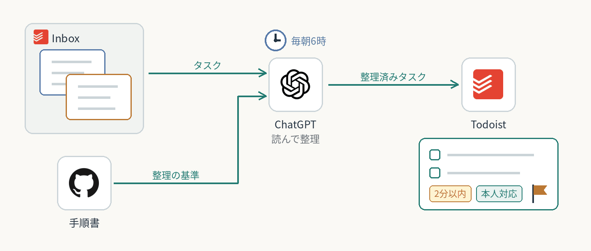
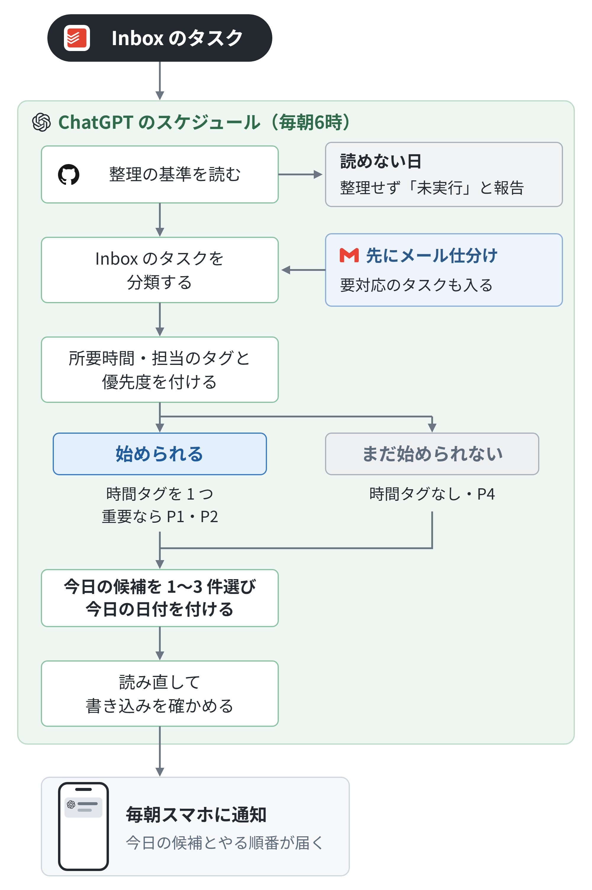

# 毎朝のTodoist整理をAIへ委譲

積み重なるタスクをChatGPTが毎朝6時（日本時間）に整理する。
**現行設定と2026-10-31朝の完了記録・更新後の再取得を行った旨の報告を確認。結果の独立検証と効果測定は未実施。**

**AI：** Inboxの分類、親子関係・タグ・優先度の整理、今日の候補の選定。  
**人間：** 判断基準・除外範囲・例外の決定と実作業。

2026-10-30から、予定の指示文は非公開の運用ルールの「Todoistと日次タスク整理」節を全文読んで従う形。基準を重複管理せず、読めない日は整理しない。日曜の大きな目標の見直しは現行運用に含めない。

- 編集はInboxだけ。他プロジェクトは直近の期限確認のみ。繰り返しプロジェクトと配下は除外。
- 確定期限と開始条件を区別。着手待ちは時間タグなし・P4。P1/P2は着手できるものだけ。
- 今日の候補は1〜3件。更新後に再取得し、日付・親子関係・既存タグの保持を確認。

同じ毎朝の処理で[メール仕分け](../daily-email-triage/)を先に行い、登録されたタスクも整理する。

整理の手順の流れ図を見る

[タスク管理の全体像](../../systems/daily-task-hub/) ／ [横断タスクボード](../../systems/cross-task-board/)

[一覧へ戻る](../../README.md)
