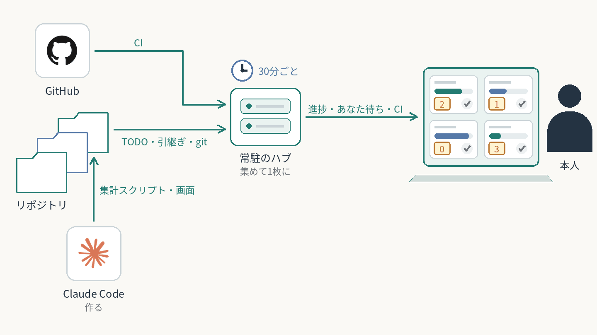

# 開発の状態を1画面に集めて常駐させる

アプリを並行して作ると、進捗・本人待ち（自分が答えるべきこと）・自動テスト（CI）の結果を知るのにリポジトリを1つずつ開く必要があった。Claude Codeに頼むと、リポジトリにある元の記録（TODO.md・作業メモ・git・GitHub）を読んで描く観測画面ができ、常に動くプログラム（ハブ）が全リポジトリの画面を1つにまとめて30分ごとに集め直す。
**2026-10-08から常駐。2026-10-31に4リポジトリの進捗・本人待ち・自動テストが1画面に並ぶことを確認。見る頻度と効果は未測定。**

**AI：** 手順書に沿って、元の記録を読み取るプログラムと画面をそのリポジトリ用に作る。  
**人間：** 足すリポジトリと固有の指標を決める。画面は見るだけ。

再利用できる工夫：

- 画面は見るためのもので、元の記録を読んで描くだけ。独自の状態も書き込む機能も持たない。
- 文章は最低限。異常（自動テストの失敗・作業メモの更新の遅れ・取得失敗）だけを上段の帯と色で出し、正常なときは何も置かない。
- ハブは設定ファイルを持たず、読み取るプログラムのあるフォルダを探して、そのプログラムを呼ぶ。足したリポジトリは自動で画面に出る。
- 画面を開いたときは手元のデータをすぐ返し、データが古ければ裏で作り直す。常駐はOSのサービス管理に任せる。
- パッケージもビルドも無し。標準ライブラリと素のHTMLだけ（自動テストの結果はGitHub CLIで取得）。

[横断タスクボードの全体像](../../systems/cross-task-board/) ／ [横断タスクボードで今日と明日を組む](../daily-cross-task-board/)

[一覧へ戻る](../../README.md)
