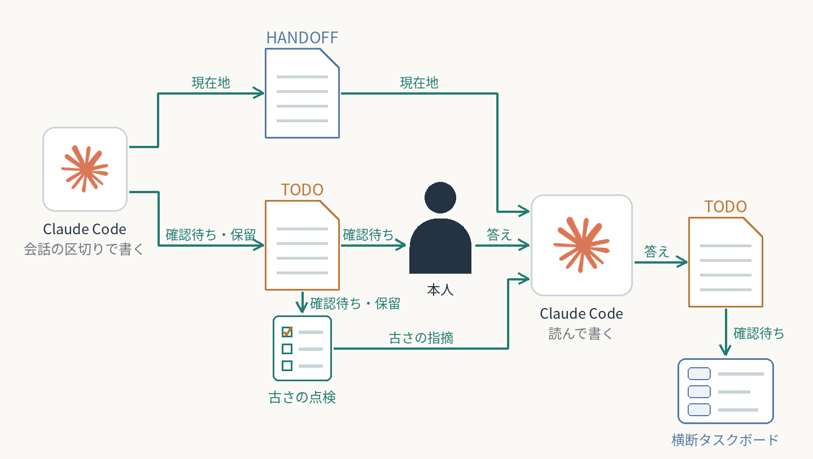

# 会話をまたぐ引き継ぎと、本人待ちの置き場

会話を閉じると、次の会話では前回の続きと、本人の判断・レビュー・作業が要る所が分からなくなる。各リポジトリの直下にHANDOFF.md（今どこまで・再開の手順）とTODO.md（タスク・確認待ち・保留）を置き、区切りごとにClaude Codeが聞かずに書く。
**決まり・点検スクリプト・フックの設定と、確認待ちをTODO.mdへ移したコミットを確認。古くならずに続くかは未検証。**

**AI：** 区切りごとに2つのファイルを更新し、確認待ちを登録し、答えを本人の言葉で記録する。会話の始めにHANDOFF.mdを読む。  
**人間：** 会話の中で判断・レビュー・作業の答えを返す。

再利用できる工夫：

- HANDOFF.mdは現在地と再開の手順だけ。履歴は積まない。
- 人間待ちはTODO.mdの「確認待ち（本人）」だけに書く。番号・種類（判断・レビュー・作業）・頼んだ日・「やってほしいこと」を書き、答えは本人の言葉で残す。ほかの場所に写さない。
- 本人への頼みは番号ではなく、会話の中で中身を書いて聞く。
- 作業のコミットのたびに、TODO.mdも同じコミットで直す。
- 点検スクリプトが書式・古さ・期限切れの保留・長く残る確認待ちを見つけ、会話の始めとコミットの直後にフックで知らせる。横断タスクボードは結果を読むだけ。
- 別の箱への写しは古くなるのでやめた（本人の判断）。

[横断タスクボードで今日と明日を組む](../daily-cross-task-board/) ／ [横断タスクボードの全体像](../../systems/cross-task-board/)

[一覧へ戻る](../../README.md)
