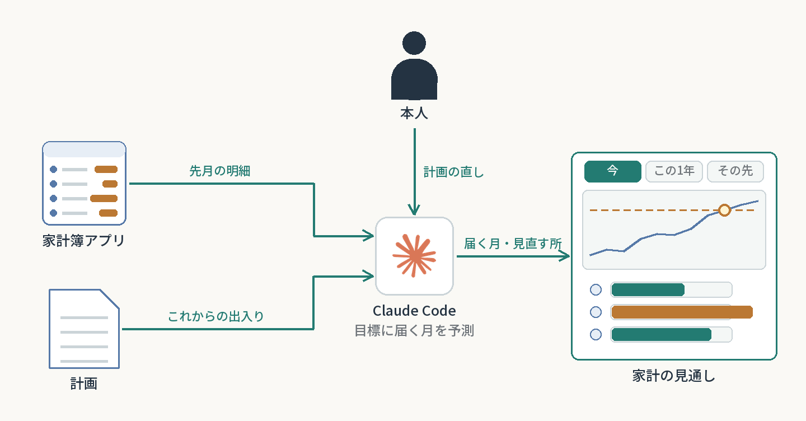

# 家計の口座が目標額にいつ届くかをAIと予測する

貯金の目標額は決めたが、表計算の家計簿は実際の値で上書きするたびに計算がつながらなくなり、いつ届くのかが分からなかった。計画（これからの収入と支出）と実績（明細）を別々のファイルに持ち、Claude Codeがスクリプトで先の月まで予測して、1つの画面に出す。
**2026-11-02に最初の予測、2026-11-10に画面を組み直した。月ごとの更新が続くか・効果は未確認。**

**AI：** 明細の読み取りと検算、予測の計算、画面の作り直し、使い方を見直す候補の洗い出し。  
**人間：** 家賃や買う時期など暮らしの値を答える。計画の直しを会話で伝える。見直すかを決める。

再利用できる工夫：

- 計画と実績を分ける。実績は計画を上書きしない。予測は、実績のある最後の月から計画の「入る − 出る」を足していく。
- 計算はスクリプト、相談は会話。明細は使う前に検算のスクリプトに通して家計簿アプリの画面の合計とも照らし、異常があれば先へ進まない。試験は架空の数字だけで回す。
- 金額はリポジトリに入れない。画面の保存先にだけ置き、口座の値を書き込もうとするとフック（AIの操作の前に動く見張り）が止める。
- 画面は時間の近い順に「今／この1年／その先」の3つに分け、いちばんの問い（目標額にいつ届くか）をいちばん上に置く。足した順に欄を縦に並べていたら、その答えがいちばん下になっていた。
- 「今」には費目ごとの実際と予算を並べる。予算を超える月が多い費目が、明細を開かなくても見える。
- 大きな家電は専用の積み立てから買う。予測は頭金と分割払い（あと払い）も計算でき、「半分たまったら買って残りを分割」を回数ごとに試算して、次の買い物が遅れない回数を本人が選んだ。

[一覧へ戻る](../../README.md)
