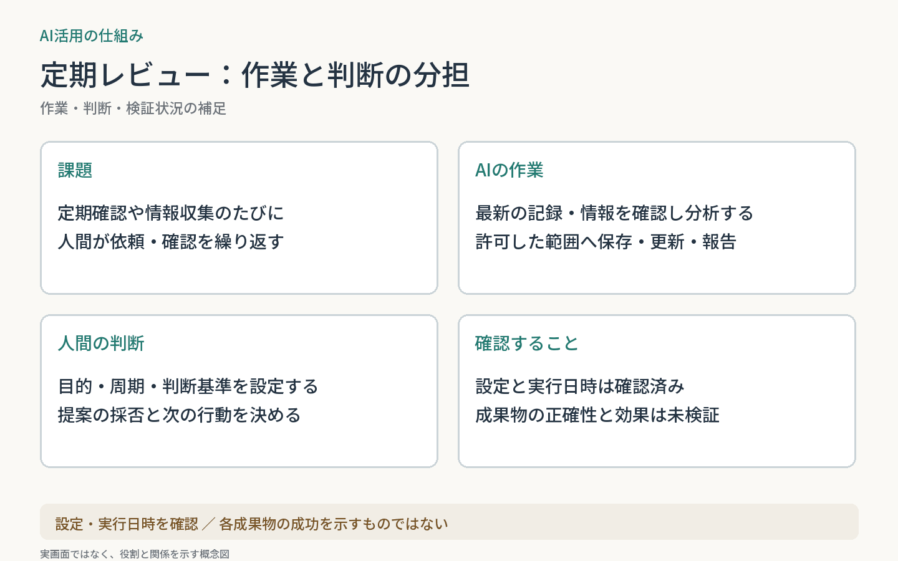

# スケジュールによる定期レビュー

定期的な情報確認・振り返りを、ChatGPTのスケジュールで実行する事例。
AIが最新情報と記録を確認・分析し、人間が提案を評価して次の行動を決める。
**2026-10-31に現行設定と、10月25日の両処理の完了記録・保存報告を確認。成果物の独立検証と効果測定は未実施。**

| 従来 | 運用の形 |
| --- | --- |
| 確認のたびに依頼する | 指定した周期でAIが確認・分析し、結果を受け取る |

**AI：** 記録の取得、情報収集、分析、許可した範囲への保存・更新、報告。  
**人間：** 目的・周期・判断基準の設定、提案の採否、次の行動。

読書レビューは毎週日曜20:30を基準とする柔軟な実行枠、会話から長期的な差分を残すコンテキスト更新は毎週日曜22:00（日本時間）。取得・保存の失敗は明示する。

週次コンテキスト更新はChatGPTのみ。Claude.aiの会話からの週次更新は2026-10-30に停止した（本人申告、関連する全体構成の記録と照合）。

両処理の直近実行は記録上completedで、同じ実行の報告に保存・更新の記載がある。実行日時だけで成功とせず、成果物の内容と継続効果は別に検証する。

作業と判断の説明図を見る

[文脈と読書の全体像](../../systems/context-reading-loop/)

[一覧へ戻る](../../README.md)
