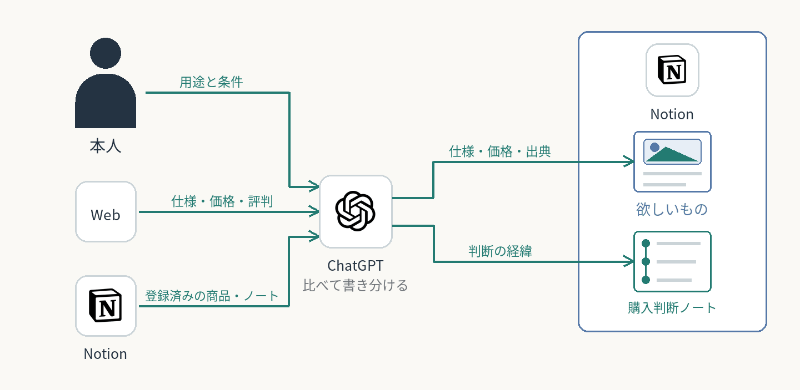

# 商品比較の判断をNotionに残す

商品比較が長くなると、仕様は残っても「何に困り、なぜ候補を変えたか」が会話に埋もれる。ChatGPTが会話と既存のNotionを照合し、判断の経緯を残す。
**購入判断ノートと欲しいもの（1商品1行）の保存内容、比較ページから開く導線を確認。継続効果は未測定。**

**AI：** 調査・比較、発言と判断の整理、既存記録への不足分の追記。  
**人間：** 用途と条件の説明、解釈の訂正、購入と使用後の評価。

商品固有の仕様・出典・注意点はNotionの欲しいもの（1商品1行）へ。比較テーマごとの独立した購入判断ノートには、きっかけ、重視した条件、候補を変えた理由、現在の結論、保留事項を置く。一覧には短いリンクだけを置く。

本人の発言・AIの解釈・確認済みの事実を区別し、過去の判断を残したまま最新結論を更新する。他の会話で生じた新しい判断を古い記録で上書きせず、購入や使用感を補わない。

記事執筆の資料としてClaude Codeに読ませるのは今後の想定で、執筆完了の実績には含めない。

[買う時期と順番の計画](../allowance-shopping-plan/)

[一覧へ戻る](../../README.md)
