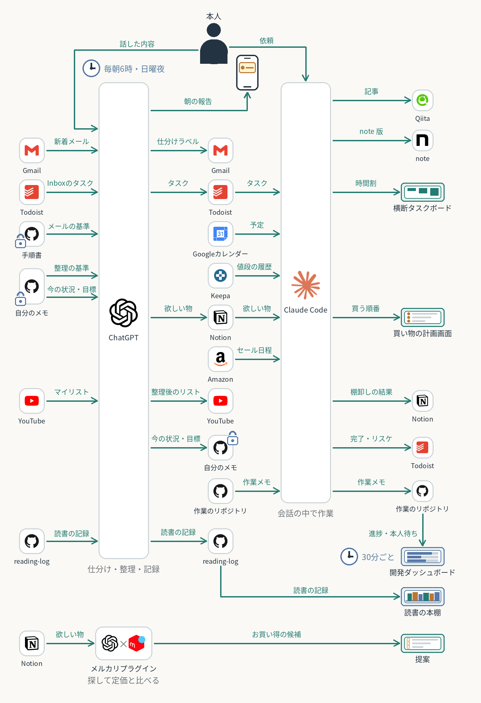
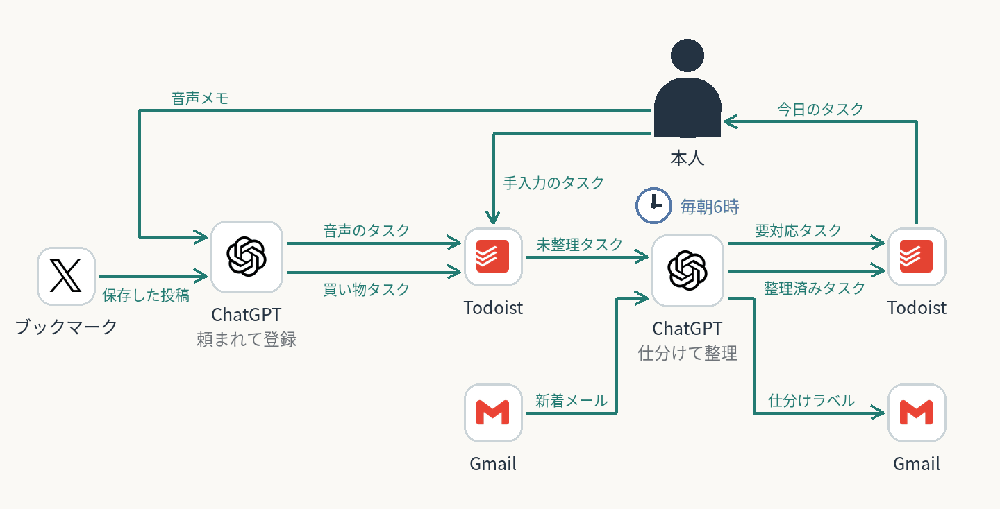
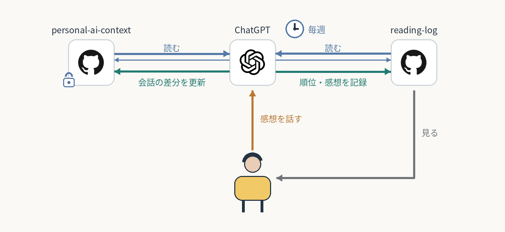
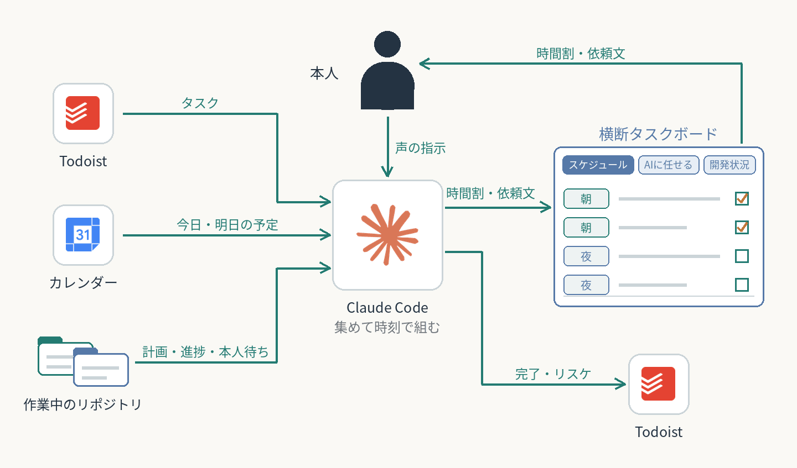
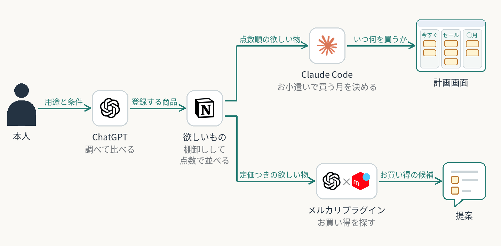
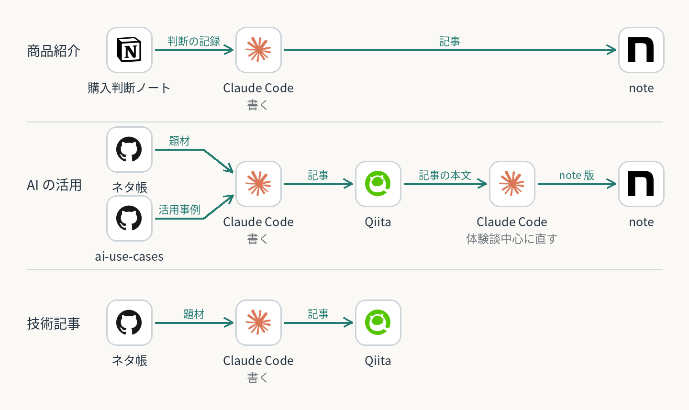

# 仕組み全体から見る

個別ケースの図は各作業を説明し、この一覧の図は複数の入力経路・AI・正本・人間の判断のつながりを説明します。

**[AIに任せている仕組みの全体図](overview/)**

| 日々のタスク管理 | 文脈と読書の循環 | 横断タスクボード |
| --- | --- | --- |
|  |  |  |
| [複数の入力 → Todoist → 整理 → 実行](daily-task-hub/) | [会話 → 文脈と読書記録 → レビュー → 読書](context-reading-loop/) | [タスク・予定・リポジトリ → ボード → 実行](cross-task-board/) |

| 欲しい物から購入まで | 記事のネタから投稿まで |
| --- | --- |
|  |  |
| [欲しい物 → Notion → 点数・値段・セール → 買う月](shopping-plan/) | [ネタ → 声で肉付け → 下書き → Qiita・note](article-writing/) |

矢印は情報・判断の流れです。すべての処理が自動で連続実行されることを意味しません。確認範囲と未確認の連携は各ページとmeta.yamlに記載しています。

[個別ケースへ戻る](../README.md)
