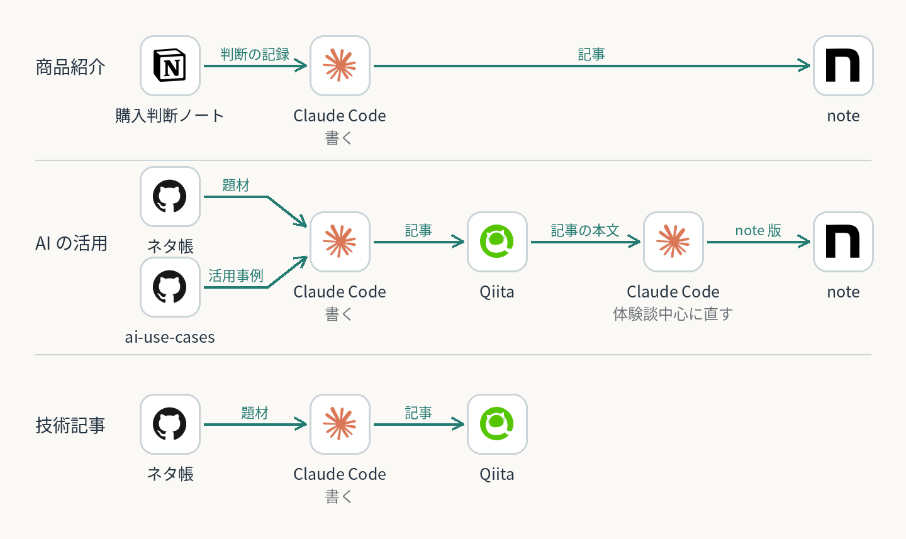

# 記事の種類で、ネタの出どころと出す先が変わる

記事は種類によって、ネタをどこから持ってきて、どこに出すかが変わる。どの記事も、ネタに本人が声で肉付けしてからClaude Codeが書き、投稿するのは本人。

| 記事の種類 | ネタの出どころ | 出す先 |
| --- | --- | --- |
| 商品紹介 | Notionの購入判断ノート | noteだけ |
| AIの活用 | ネタ帳（記事の候補の置き場）とこのカタログ | Qiitaのあと、note向けに書き直してnoteにも |
| 技術記事 | ネタ帳 | Qiitaだけ |

矢印はデータが動く向き。出す先の使い分けは本人の決定（2026-11-02の本人「商品紹介ってノートにしか公開しませんよ」）。本人の声と直しは全部の種類に共通なので、この図には描かず個別ケースに任せる。

確認できた実績は、AIの活用の記事1本のQiita公開と公開後の書き直しまで（2026-10-31）。note版はレビュー中。購入判断ノートから書いた商品紹介の記事はまだ無い。効果は未測定。

関連する個別ケース：[聞き取りから記事を書き、投稿まで](../../cases/article-drafting-workflow/) ／ [商品比較の判断](../../cases/shopping-decision-notes/)

[全体構成一覧](../README.md) ／ [トップ](../../README.md)
