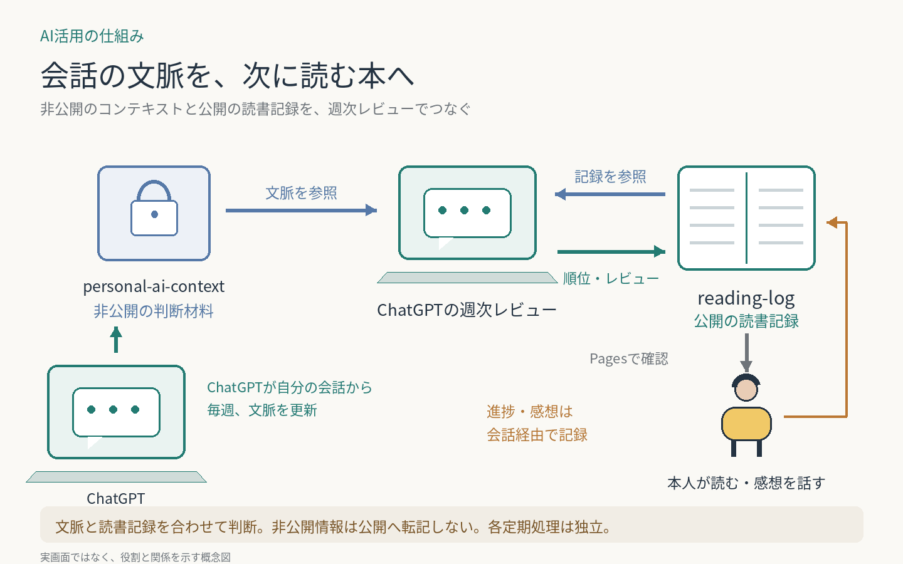

# 会話の文脈を、次に読む本へつなぐ

ChatGPTが、会話から長期的に必要な差分を毎週personal-ai-contextへ整理する。読書レビューは、この文脈・参照できる最近の会話・reading-logの読書記録を合わせて、次に読む本を判断する。

| 正本・処理 | 担うこと |
| --- | --- |
| personal-ai-context（非公開） | 目標・判断基準・継続的な制約。ChatGPTが会話の差分を毎週更新し、どのAIも最新mainを読む |
| reading-log（公開） | 本、進捗、本人の感想、読後アクション、読む順位、週次レビュー |
| ChatGPTの週次読書レビュー | 両方の正本と取得できた会話を参照。reading_order・レビューをreading-logへ反映 |
| GitHub Pages・本人 | 本棚と「次に読む」を見て読む。進捗・感想を会話経由で再びreading-logへ記録 |

**読書レビューからpersonal-ai-contextへは書き戻さない。** 非公開情報は判断材料にとどめ、公開の順位理由は必要な範囲へ一般化する。会話全文は公開しない。

定例更新はChatGPTの週1回だけで、書き込み直前に最新mainを確認する。2026-10-30まではClaude.aiの会話からも週1回更新していたが、Claude.aiではほとんど会話しないため止めた（本人の判断。Claude側の定期実行は無効にしたことを設定で確認）。読書レビューは実行時に取得できる最新状態を使い、同じ週のコンテキスト更新完了を待つイベント連鎖ではない。

連携仕様とChatGPT側の有効設定を確認。毎回の保存成功、推薦の効果は検証していない。

関連する個別ケース：[定期レビュー](../../cases/scheduled-reviews/)  
外部の正本：[reading-log](https://github.com/n-yoshida-dev/reading-log) ／ personal-ai-context（非公開のためリンクなし）

[全体構成一覧](../README.md) ／ [トップ](../../README.md)
