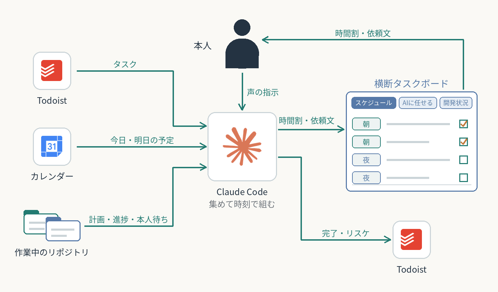

# 今日やることを1枚のボードにまとめる

Todoistだけでは、学習計画・アプリ開発・執筆などリポジトリ側の作業と並べた本当の優先順位が分からない。PCのClaude Codeが入力をまとめて読み、時刻つきのスケジュールをアーティファクト（claude.ai上のWebページ）の「横断タスクボード」に書く。本人はボードを見て実行し、声で指示する。

| 段階・正本 | 役割 |
| --- | --- |
| 入力（読むだけ） | Todoist（Inboxと各プロジェクト。買い物・繰り返しは見ない。日付は実行日として読み、締め切りと前提条件は説明欄の該当する行だけを読む）、Googleカレンダー（今日・明日）、各リポジトリの計画と引き継ぎ、各リポジトリの本人待ち（TODO.mdを点検スクリプトで読んだ結果）、各アプリの開発ダッシュボード |
| 組む | 本人が「リスト作って」と頼んだとき、PCのClaude Code（Windowsのフォルダで開いた会話。WSLに残るリポジトリも読む）が、期限・所要時間・AIに任せられるかでタスクを選び、夜と朝の時間帯に時刻で割り付ける |
| 正本 | ボードの中身はアーティファクトのデータベース（タスク・時間枠・その日の方針）。ページは表示するだけで、日々の更新ではデータベースだけを書き換える |
| 見る・指示する | 本人がボードをClaudeデスクトップの横に開いて見る。チェックや声で完了・リスケ・差し込みを伝える |
| 書き戻す | Todoistの完了・リスケ・削除は本人が指示したときだけ。削除は対象の名前を言ってから |

2026-10-21〜22の変化：Claude Codeで行うタスクに作業フォルダを表示（タスクの名前だけでは、どこで作業するか分からないため）。枠に入らなかったタスクと「次に入れるならこれ」を表の下に表示。「開発状況」タブに各アプリのダッシュボードを取り込み、データを見る場所を1つにした（本人の判断）。詳しい画面はボードの上に重ねて開く。

2026-10-23〜28の変化：夜の時間割の型、平日の日中の「配分の枠」（時刻を決めず上から順）、「AIに任せる」タブを追加。別のリポジトリの作業は、Claude Codeが依頼文を作り、本人がその作業用に新しく開く会話に貼って渡す。開発状況を見る入口はボードに一本化した（本人の判断）。組み方の工夫は[個別ケース](../../cases/daily-cross-task-board/)に記載。

2026-10-29の変化：本人待ち（判断・レビュー・本人の作業）とタスクは、各リポジトリ直下のTODO.mdだけに置く形にした。ボードはそれを読むだけで、ほかのリポジトリのTODO.mdを書き換えない。古さや書式の崩れは点検スクリプトに見つけさせ、会話の始めとコミットの直後にフックで知らせる。それまでの本人待ちの付箋の箱（Beads）は、TODO.mdや引き継ぎの写しだった。引き継ぎの手順に乗っておらず古くなった（生きている64件のうち30件が、作ってから一度も更新されていなかった）ため、やめた（本人の判断）。

2026-10-31の変化：毎朝のTodoist整理と役割を分けた。順番を気にせず「今日やるべきこと」を決めるのはChatGPTの毎朝の整理、本腰を入れてPCで作業するときの細かい順番を決めるのがこのボード（本人の判断）。ChatGPTの会話に散らばっていたやりたいことも、Todoistへ集めた。PCともAIとも関係ない作業（片付け・買い出しなど）はボードに載せず、毎朝の整理と月1回の棚卸しで拾う。ボードには、期限の無いタスクからAIに任せられるものを毎回1〜3件、依頼文つきで出す。毎月の最初の週末に、Todoistの全件を本人と棚卸しする。ログインが要るブラウザ作業は、Windows側のClaudeの会話にChromeを操作させる方法を優先し、ChatGPT Workは予備にする（PCの前にいないときはChatGPT Work）。いずれも本人の判断で、運用の記録はまだ無い。

2026-11-04〜08の変化：作業の置き場を取り組みごとのフォルダに組み替え、ボードの会話をWindowsのフォルダで開くようにした（WSLに残るリポジトリは道具が読みに行く）。これで、ボードの会話から内蔵ブラウザと本人のChrome（拡張機能）を直接動かせる。ログインの要らないページや本人に見せながら進める作業は内蔵ブラウザ、本人のChromeにしかログインが無いサイトは拡張機能、と作業ごとに選ぶ（本人「メリデメを整理して、都度使い分けるように」）。点検の道具は、ボードでは未完なのにTODO.mdでは閉じた物と、AIに任せて作業中のタスクの相手のリポジトリの最後のコミット（日時と件名）も出すようにした。済んでいたのにボードが古いタスクと、1週間止まっていた依頼に気づけなかったため。ボードに「日付」のタブを足した。日ごとの一覧と7日の帯、過去3日に済ませた数、先送りの回数（3回で赤）、締め切りまでの日数、空き時間（5・15・30分、スマホ）での絞り込み、今日これだけはやる物の★がある。Todoistの日付は締め切りではなく実行日として扱い、締め切りと前提条件は説明欄から該当する行だけを毎回読む（本人「それは締め切りじゃなくて実行日ですからね」）。Todoistで動いた日付をボードが拾えていなかったことに本人が気づき、日付の食い違いも毎回比べるようにした。

自動実行はしない。クラウドのセッションからはPCの中が見えないため、そのセッションで作った日は「Todoistとpush済みのものだけで作った」と記録する。毎朝のTodoist整理とは独立して動き、整理に続けて実行するものではない。

作業記録とコミット履歴で、ボードの作成、書き込んだ件数とデータベースの件数の一致、Todoistへ反映したあとの確認、開発状況の取り込みの成功を確かめた。記録は15日分（2026-10-21〜11-08）で、毎日の継続と効果は未確認。

関連する全体構成：[日々のタスク管理](../daily-task-hub/)  
関連する個別ケース：[横断タスクボードで今日と明日を組む](../../cases/daily-cross-task-board/) ／ [Todoist整理](../../cases/daily-todoist-triage/) ／ [次の会話への作業メモと、本人待ちの置き場](../../cases/handoff-and-todo-files/)

[全体構成一覧](../README.md) ／ [トップ](../../README.md)
