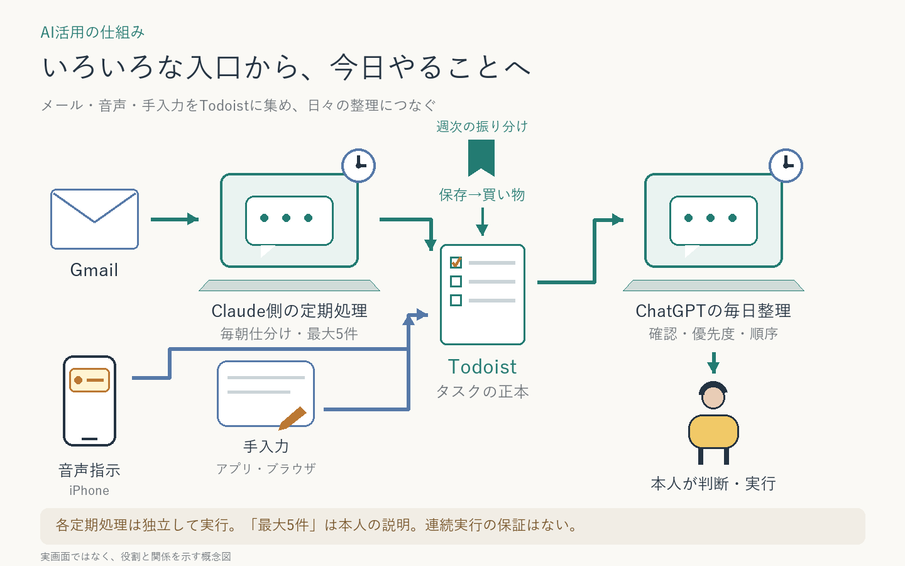

# 複数の入力をTodoistへ集め、毎日整理する

メールからの自動登録、iPhoneのアクションボタンからの音声指示、アプリ・ブラウザでの手入力をTodoistへ集約する。ChatGPTがInboxを整理し、本人は整理結果を確認して実際の作業を行う。

| 段階 | 担当と役割 |
| --- | --- |
| メールを拾う | Claude側の朝の定期処理がGmailを仕分け。今回の本人説明では対応・確認事項を最大5件登録 |
| 思いつきを入れる | 本人が音声指示、アプリ、ブラウザから入力。音声の中継アプリ・内部経路は未確認 |
| 保存から買い物へ | ChatGPTのブックマーク整理で、近々買うものを買い物プロジェクトへ。初回登録を確認、週次設定済み |
| 集約する | Todoistがタスク管理の正本。主な整理対象はInbox。ブックマークからの買い物登録は別プロジェクトで、日次Inbox整理との自動連続実行は保証しない |
| 整理する | ChatGPTの毎朝の処理が分類、親子関係、時間・委譲先、優先度、実施順を整理 |
| 行動する | 本人が結果を確認して実行。タグ付けだけで別AIの作業が始まるわけではない |

繰り返しプロジェクトは棚卸しから除外。他プロジェクトの期限確認は読み取りだけ。整理の書き込みはInboxに限定する。

**図は情報の流れを示す。入力後ただちに後続処理が起動する連鎖ではなく、定期処理はそれぞれ独立して動く。** 同日の新規入力が整理に間に合うかは実行順序に依存する。

メールケースの記録では実行環境はClaude Codeのルーティン、今回の本人説明ではClaude.aiと呼ばれているため、全体図では「Claude側」とする。最大5件の上限と音声経路は本人説明に基づき、設定を直接検証していない。要確認メールの全件タスク化も未確認。

2026-10-21からは、整理後のTodoistを各リポジトリの作業・予定と並べて1日の時刻割りにする[横断タスクボード](../cross-task-board/)を別の全体構成として試用中。そこではClaude Codeが本人の指示を受けたときだけ、Todoistのタスクを完了・日付変更する。

関連する個別ケース：[メール仕分け](../../cases/daily-email-triage/) ／ [Todoist整理](../../cases/daily-todoist-triage/) ／ [ブックマーク整理](../../cases/bookmark-to-action/)

[全体構成一覧](../README.md) ／ [トップ](../../README.md)
