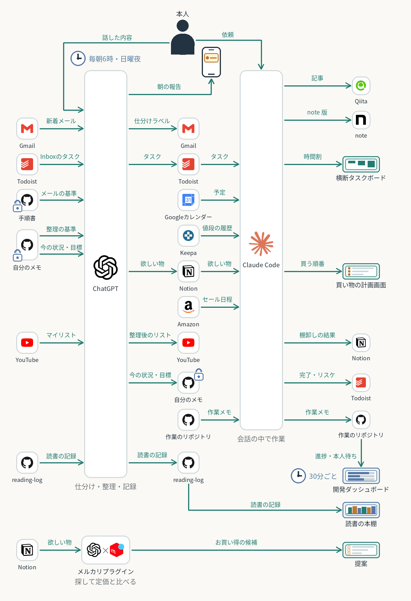

# AIに任せている仕組みの全体図

AIに任せている仕組みを、データの流れで1枚にまとめた入口。左が読まれる側、中央がChatGPTとClaude Code、右が書かれる側。本人は上から話す・頼むだけで、朝の報告はスマホに届く。

| 流れ | 進む先 |
| --- | --- |
| メール・Todoist・予定 | [日々のタスク管理](../daily-task-hub/) ／ [横断タスクボード](../cross-task-board/) |
| 自分のメモ・読書の記録 | [文脈と読書の循環](../context-reading-loop/) |
| 欲しい物・値段・セール | [買い物の計画](../../cases/allowance-shopping-plan/) ／ [商品比較の判断](../../cases/shopping-decision-notes/) |
| マイリスト | [YouTube整理](../../cases/youtube-playlist-cleanup/) |
| 作業メモ | [作業メモと本人待ち](../../cases/handoff-and-todo-files/) ／ [開発ダッシュボード](../../cases/dev-dashboard-hub/) |
| 記事 | [下書きから投稿まで](../../cases/article-drafting-workflow/) |

矢印はデータが動く向き。全部が続けて自動で動くわけではなく、定期実行は時計の印の物だけ。今動いている流れだけを描き、止めている仕組みと予定の流れは描かない。確認の範囲は各ページとmeta.yamlに記載。

[全体構成一覧](../README.md) ／ [トップ](../../README.md)
