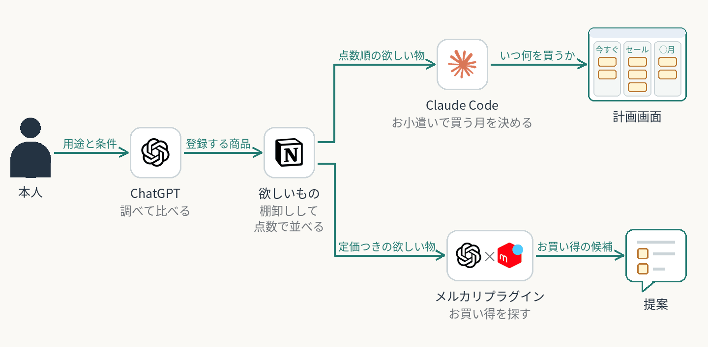

# 欲しい物は Notion の 1 つ

欲しい物の正本はNotionの欲しいもの（1商品1行）だけにする。調べて登録する、買う月を決める、お買い得を探すの3つの仕組みが、同じ一覧を読む。

| 段階・正本 | 役割 |
| --- | --- |
| 調べて比べる | 本人が用途と条件を話し、ChatGPTが会話の中で比べて、決めた物をNotionへ登録。比べた理由は購入判断ノートへ |
| Notionの欲しいもの | 正本。棚卸しと5つの質問の答えから、数式の列が点数を出す |
| 買う月を決める | Claude Codeが点数順の一覧・値段の履歴・セール日程・今あるお小遣いから、計画画面に買う月を出す |
| お買い得を探す | ChatGPTのメルカリプラグインが定価つきの一覧を読み、状態と値段を定価と比べて提案 |
| 本人 | 計画画面と提案を見て、買う順と買うかを決める |

矢印は情報の流れ。3つの仕組みはそれぞれ頼んだときに動き、登録から計画・提案へ自動で続けて動くわけではない。買う順は計画画面だけに持つ。

登録・点数・計画画面は各ケースで確認。メルカリの提案で買えた実績は本人の説明で、記録は未確認。

関連する個別ケース：[購入判断ノート](../../cases/shopping-decision-notes/) ／ [買い物計画](../../cases/allowance-shopping-plan/)

[全体構成一覧](../README.md) ／ [トップ](../../README.md)
